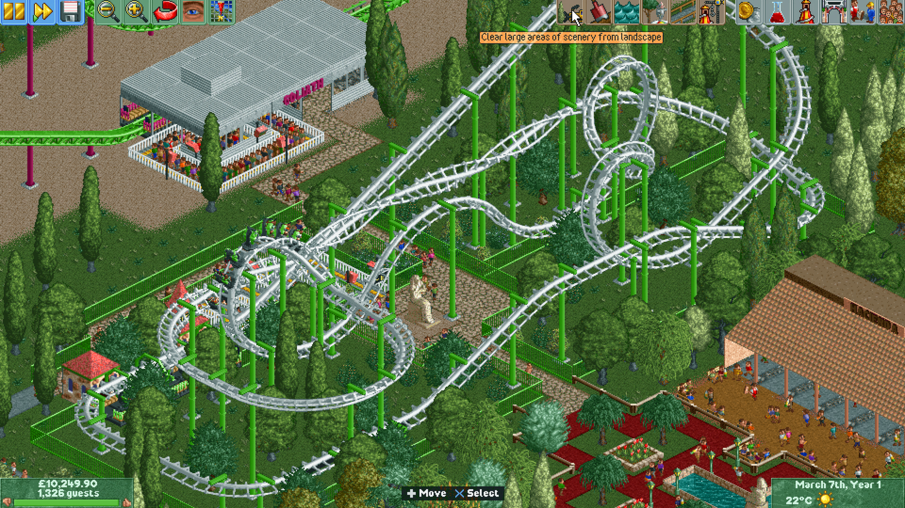
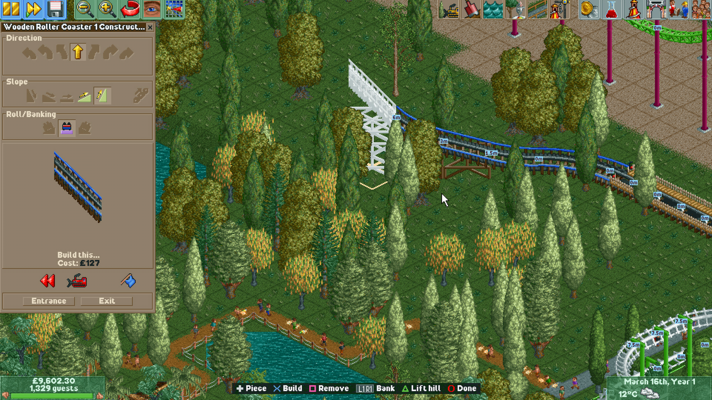
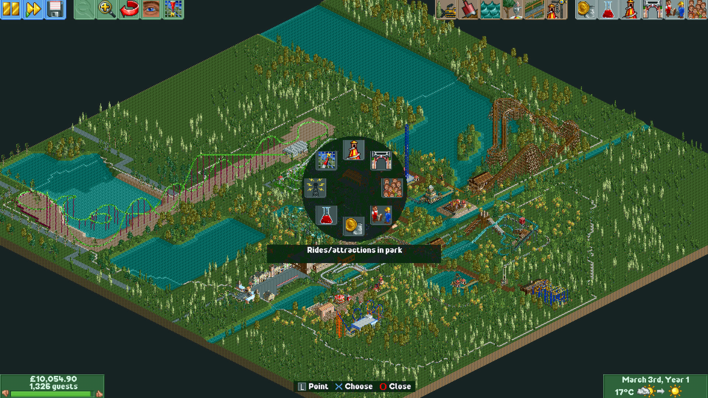
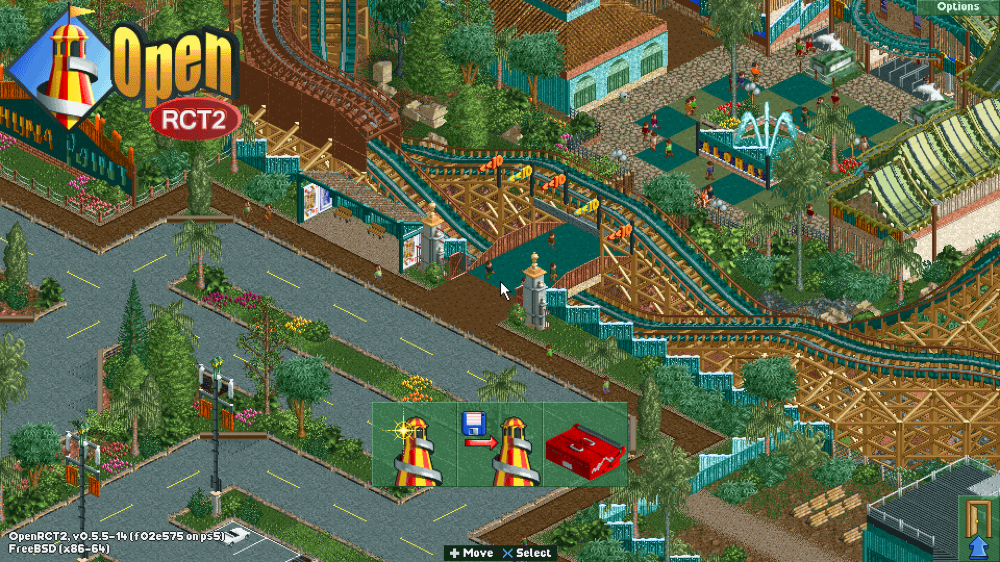
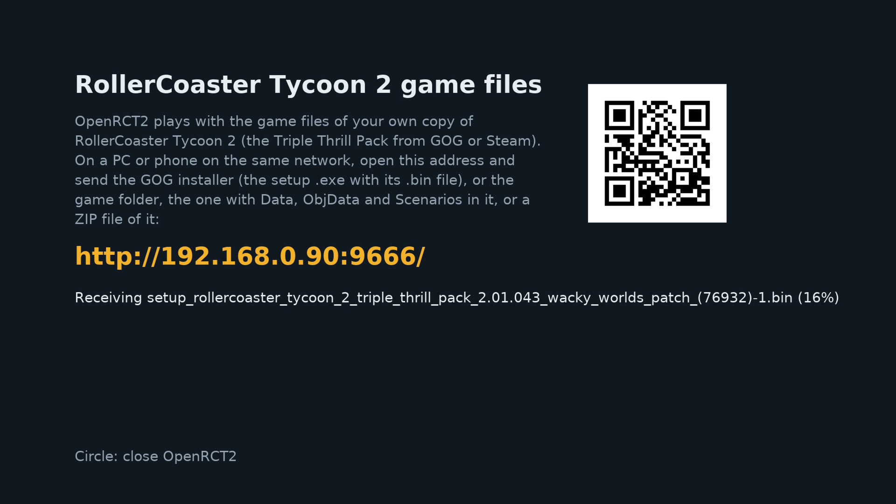
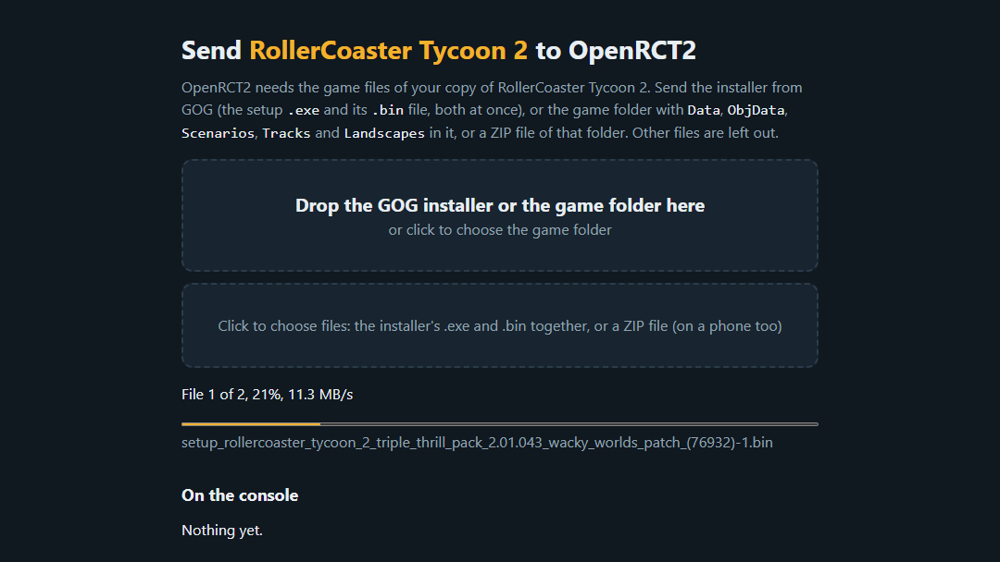

# OpenRCT2 for PS5 (native)

[OpenRCT2](https://openrct2.io/), the open-source re-implementation of RollerCoaster Tycoon 2,
running as a native PS5 title: its own home-screen icon, 1080p at 60 frames per second, music and
sound, and made to be played with the DualSense alone. The left stick or the touchpad moves a
pointer, the d-pad jumps between buttons and through every list, Options and Triangle open radial
menus of the build tools and the park windows, track and paths are built on the d-pad, and the
bottom of the screen shows what each button does at that moment. Bring your own copy of
RollerCoaster Tycoon 2: on its first start the game takes the GOG installer, the game folder or a
ZIP file of it, sent from a PC or phone browser.

  
  

  
  

## Requirements

- A jailbroken PS5 with kstuff (fake-signed executables) and
  [ShadowMountPlus](https://github.com/drakmor/ShadowMountPlus). Tested on firmware 13.00.
- Your own RollerCoaster Tycoon 2: the Triple Thrill Pack from GOG (its offline installer) or the
  game folder of an installed copy, from GOG or Steam.

## Install

1. Download `PPSA99728.zip` from the [releases](../../releases) and check it against
   `PPSA99728.zip.sha256`.
2. Extract it and copy the `PPSA99728` folder to `/data/homebrew/` (FTP, ps5upload or USB).
3. ShadowMountPlus registers it within a few seconds and **OpenRCT2** appears on the home screen.

## Your game files

The first time it starts, OpenRCT2 shows an address (for example `http://192.168.1.50:9666/`) and
its QR code. Open it in a browser on a PC or phone on the same network and send one of these:

- **The GOG installer.** The setup `.exe` and its `.bin` file from GOG's offline installer, chosen
  or dropped together; dropping the whole download folder works too. The console takes the game
  files out of it and then deletes it. On a wired PS5 the installer arrives in about a minute and
  is unpacked in about a minute and a half.
- **The game folder**, the one with `Data`, `ObjData`, `Scenarios`, `Tracks` and `Landscapes` in
  it. Only those folders are sent.
- **A ZIP file of that folder**, for phones, which cannot send folders.

Both the page and the TV show what arrived, and the game starts by itself once the files are
complete. Circle closes it in the meantime.

  
  

## Controls

The buttons act on what is under the pointer, and the middle of the bottom toolbar lists what they
do right now.

| Input | In the park | Over a window | Building track or a bridge path |
| --- | --- | --- | --- |
| Left stick | The pointer; pushed against the screen's edge it scrolls the park | | |
| Touchpad | The pointer, like a laptop's; a click is Cross | | |
| D-pad | Jump to the nearest button that way (up reaches the toolbar) | Button to button; through lists, sliders and dropdowns | Turn left or right, slope up or down |
| Cross | Click, hold to drag | Click | Build the piece (held, keeps building) |
| Square | Remove (scenery, paths) | Right click | Take the last piece away |
| Circle | Leave the tool and close its window | Close the dropdown or the window | Stop building |
| Triangle | Park windows; rotate what is being placed | | Chain lift |
| Options | Build tools | | |
| L1 / R1 | Rotate the view | Previous / next tab | Bank left / right |
| L2 / R2 | Zoom out / in, towards the pointer | | |
| Right stick | Scroll the park | Scroll the list under the pointer | |
| L3 / R3 | Pause / rotate the view | | |

Options and Triangle open their radial menus in the middle of the screen: the build tools (rides,
paths, scenery, land, water, clearing scenery) and the park windows (rides, park, guests, staff,
finances, research, messages, map). Hold the button, point with the stick and let go, or tap it,
point and press Cross. While placing scenery, up and down on the d-pad raise and lower it. Text
boxes open the PS5 keyboard. The game's *Gamepad deadzone* and *Gamepad sensitivity* options apply
to the pointer too. Saves and settings stay on the console.

Multiplayer and the other online features are left out.

## Building and internals

See [DEVELOPMENT.md](DEVELOPMENT.md) for the build, the changes to OpenRCT2 and SDL, the console
test loop and the PS5 behaviour learned along the way. Licenses and credits: [LICENSE](LICENSE)
(GPL v3, as OpenRCT2) and [THIRD_PARTY_NOTICES.md](THIRD_PARTY_NOTICES.md).
